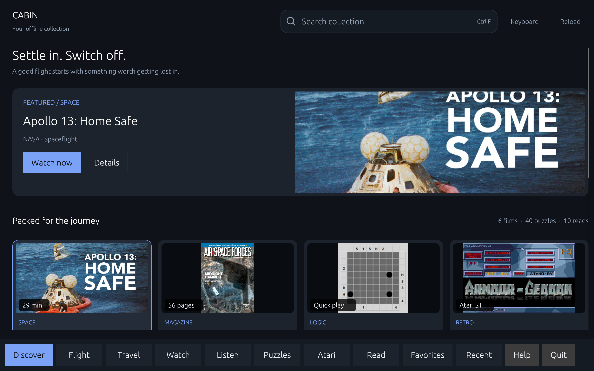

# Cabin



A native Rust flight library with large text, touch-sized controls, background artwork loading, keyboard navigation, favorites and resume tracking. All browsing, artwork and playback work offline.

<!-- counts:start -->
82 catalogue entries: 40 native puzzles; 26 Atari games (13 boot-verified and visible by default); 6 active documentaries (6h 15m); 8 magazines; 2 illustrated books; and 0 local audio items.
<!-- counts:end -->

The active history shelf includes two Mary Beard Roman Empire documentaries, the Vasa documentary, illustrated books on Roman daily life and Swedish history, NASA documentaries and the Vietnam series. Retro reading includes ST Action 32 and 44, ST Format 24 and 80, and Atari ST Review 11.

The rejected city/European travel picks and Pacific-war documentaries are removed from the active library. Original downloads are preserved. Travel curation is paused in `data/travel-picks.json`; the recorded preference is seas, islands, beaches and mountains in the Americas, Asia and Caribbean. No replacement selection is silently reintroduced.

## Use

Open **Cabin** from the desktop launcher or run `~/.local/bin/cabin`.

- Tap a card to see details; swipe to scroll. The bottom navigation stays available. **Keyboard** opens the touch keyboard.
- Arrows move between cards; Enter opens details or launches; Space launches from details. Escape goes back, Ctrl+F searches, Q quits, F11 toggles fullscreen.
- **Flight** accepts a flight length and proposes films, reading and games within it. Film durations use saved progress; reading/game sessions are estimates. Battery data comes from `/sys/class/power_supply/BAT0` and uses current discharge, when available.
- **Listen** scans `~/music/flight/` recursively. Add MP3, M4A/M4B, FLAC, Ogg/Opus, WAV or AAC and tap **Scan audio folder**. No audio has been downloaded automatically.
- Videos use mpv fullscreen, safe automatic hardware decode, volume normalization and visible subtitles. Music/podcasts/audiobooks use mpv without video and with resume.
- PDFs open in Evince. Illustrated HTML books open locally in the browser with larger text and bundled images; historical books are labelled with their period.
- Atari games open in Hatari fullscreen. F12 opens settings/disks; Right Alt+M releases the mouse. Unverified games are hidden until **Show unverified games** is enabled. [Boot audit and evidence](docs/ATARI-COMPATIBILITY.md).

“Verified” for Atari means an identifiable game screen was reached, not that a full playthrough passed. The expansion mission for Voyage Beyond remains unverified even though the base game boots.

The home screen derives its hero and mixed shelves from the catalogue. **Continue watching** uses mpv's `watch_later` files, with progress on cards and detail pages. Positions shorter than five seconds or near the end are not suggested as unfinished.

## Controllers

Cabin supports hot-plugged gamepads through [GilRs](https://docs.rs/gilrs/latest/gilrs/), including SDL/Steam controller mappings. No controller is required for touch or keyboard use.

- D-pad or left stick moves the visible focus ring; A / PlayStation cross opens a card and launches from its detail page. B / circle goes back.
- LB/RB switches sections. X / square toggles a favorite. Y / triangle opens search; use the D-pad and A to type on the on-screen keyboard, and B to finish. Start opens help.
- In Flight, left/right adjusts the duration by 15 minutes and up/down selects the suggested line-up. In details, up/down scrolls and left/right changes gallery images.
- Input runs on a background thread with a stick deadzone and delayed repeat. Cabin ignores controller actions when unfocused or while its launched player/game is running, and requests focus when that process exits.

Controller mapping, deadzone, repeat timing and search-key navigation have automated tests. No physical controller was attached during verification, so hardware behavior remains to be playtested. These controls navigate Cabin; individual games and readers retain their own controls, and mouse/keyboard-only games are not automatically remapped.

The search toolbar uses a rounded field, centered text, a clear action and an accent focus ring. Its secondary actions wrap below the field on narrow displays.

## Build, install and validate

```sh
cargo build --release --locked --offline
cargo test --offline
python3 -m unittest discover -s scripts -p 'test_*.py'
bin/install
cabin check --json
```

Installation is per-user. Runtime integrations are `mpv`, `evince`, `hatari`, `puzzles`, Python, FFmpeg and standard checksum utilities. No shell is used to launch library content.

`check --json` retains `items`, `errors`, `offline` and reports missing/non-executable players, partial downloads, zero-byte files, hash mismatches, files inspected and hashes verified. It exits nonzero for any failed check. The source manifests are checked against SHA-256.

`list --json` exports the catalogue. `launch ID --dry-run` prints the executable and exact argument array. `--section read`, `--detail ITEM_ID`, `--windowed`, and `--screenshot PATH.png` support inspection.

## Content maintenance

- `scripts/download_videos.sh /path/to/sources.txt` downloads up to 720p video plus English manual/automatic captions and publisher metadata.
- `scripts/fetch_subtitles.py` checks all downloaded films and fetches missing English captions. The checked collection has subtitles for all 17 downloaded films, including archived selections; see `data/subtitle-report.json`.
- `scripts/add_travel.py` respects the travel enable flag, adds the retro-magazine manifest, logs failed sources, continues successful imports, then reports skipped sources and exits nonzero if any failed.
- `scripts/add_history.py` adds the Rome/Sweden content. Download its film sources before running.
- `scripts/prepare_library.py --audio-only` imports local audio offline without rebuilding other shelves. Full preparation is a network-assisted base-library rebuild; follow it with the travel/history import scripts.
- `scripts/update_readme_counts.py` regenerates the counts above from the installed catalogue.

## Storage and preservation

Catalogue/artwork: `~/.local/share/cabin/`. Override the catalogue with `CABIN_LIBRARY`. Favorites, recent items and logs: `~/.local/state/cabin/`. Films: `~/videos/flight/documentaries/`; magazines: `~/magazines/flight/`; books: `~/books/flight/`; audio: `~/music/flight/`.

Original Atari images remain in `~/games/atari-st/`. Writable copies in `~/.local/state/atari-games/` are reused without overwriting existing saves. The boot audit used isolated, write-protected originals.

Downloaded media and third-party artwork retain their original rights and are not bundled in the source repository. Original URLs are retained in catalogue details and manifests.

## Native Wayland trial

`cabin --wayland` uses native Wayland and compositor scaling without the XWayland zoom adjustment. On Hyprland at scale 2, the test rendered at 2880×1800; Hyprland reported `xwayland: false`, `fullscreen: 2`.

XWayland remains the default because physical touchscreen gestures have not yet been verified under native Wayland. The earlier native build stalled; the current bounded test completed successfully. The touchscreen is detected, but rendering alone does not prove gesture behavior. No desktop configuration changes were made.
